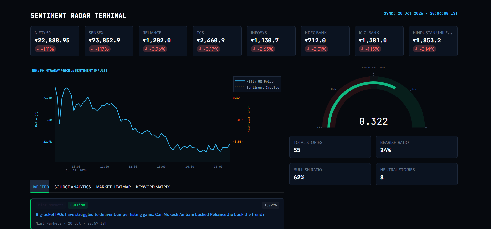
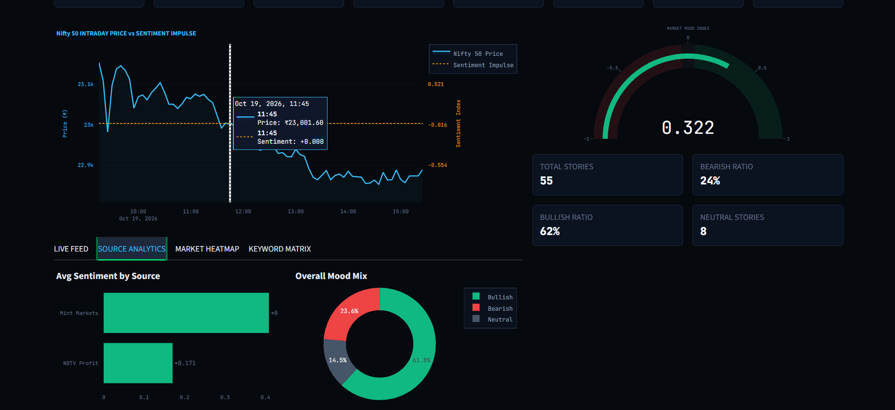
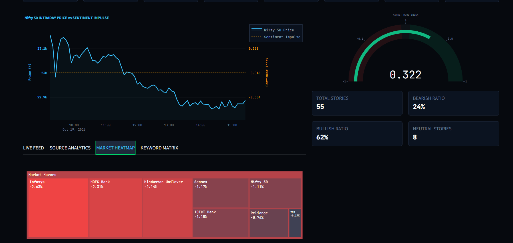
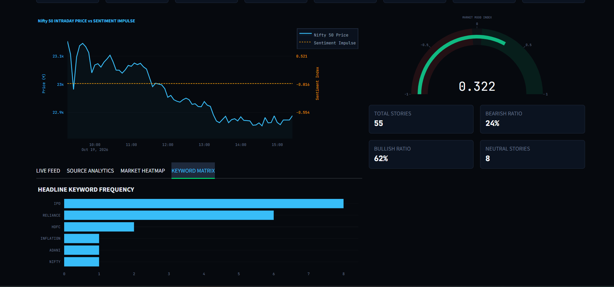

# Sentiment Radar Terminal (NSE/BSE)

A real-time financial news sentiment analysis and trading terminal dashboard designed for Indian equity markets (NSE/BSE). Built with **Streamlit**, **Plotly**, and an enhanced **VADER Natural Language Processing (NLP)** engine, this application ingests live financial RSS news streams, processes headlines using a domain-specific financial lexicon, and correlates market mood with intraday price action.

---

## Abstract

Financial market dynamics in modern equity trading are heavily influenced by the speed and tone of digital information dissemination. Traditional technical analysis often fails to capture sudden market turns driven by qualitative news events such as policy updates, earnings reports, or regulatory actions.

**Sentiment Radar Terminal** bridges qualitative news analytics and quantitative intraday market action. By ingesting financial RSS feeds from leading Indian market portals—including *Mint*, *NDTV Profit*, *The Economic Times*, *Business Standard*, and *Moneycontrol*—the terminal evaluates news headlines against an augmented financial dictionary customized for Indian markets (e.g., scoring *RBI rate cuts*, *FII inflows*, *IPO listings*, or *earnings misses*). 

The platform aggregates scores into a unified **Market Mood Index**, overlays rolling sentiment signals directly against intraday stock/index price trends, and provides interactive analytics via treemaps, source bias matrices, and headline keyword frequency distributions.

---

## Key Features

* **Real-Time Ticker Stream**: Live price, net change, and percentage movement updates across key indices (Nifty 50, Sensex) and top NSE equities (Reliance, TCS, Infosys, HDFC Bank, ICICI Bank, etc.).
* **Intraday Price vs. Sentiment Overlay**: Dual-axis Plotly line charts mapping intraday stock prices alongside continuous news sentiment impulse curves.
* **Market Mood Gauge**: Real-time visual gauge displaying the session's overall compound sentiment score ($[-1.0, +1.0]$).
* **Live Feed & Badge Filtering**: Categorized streaming feed displaying headline links, source badges, publication timestamps, and numerical sentiment scores.
* **Market Movers Treemap (Heatmap)**: Color-coded stock performance grid displaying intraday gainers and losers weighted by percentage shifts.
* **Source Analytics**: Breakdown of sentiment polarity across individual news publishers to inspect bias and tone variations.
* **Keyword Frequency Matrix**: Term frequency extraction tracking market narrative drivers (*IPO*, *Reliance*, *RBI*, *Adani*, *Inflation*, etc.).

---

## Terminal Screenshots & Interface Overview

### 1. Main Overview & Live Feed
The primary terminal view features top ticker cards, the dual-axis intraday price vs. sentiment chart, the Market Mood Index gauge, overall session metrics, and the live news feed stream.



---

### 2. Source Analytics Breakdown
The **Source Analytics** module compares average sentiment scores across different media outlets alongside an overall pie chart distribution of Bullish, Bearish, and Neutral coverage.



---

### 3. Market Heatmap Treemap
The **Market Heatmap** provides an immediate visual summary of market gainers and decliners across tracked Indian equities and indices.



---

### 4. Keyword Frequency Matrix
The **Keyword Matrix** extracts and ranks dominant market drivers and keywords appearing across live headlines.



---

## Project Structure

```text
indian-market/
├── app.py              # Main Streamlit application UI and Plotly dashboard
├── market_data.py      # Market data fetching via yfinance (prices & quotes)
├── news_fetcher.py     # RSS news ingestion & feed parser logic
├── sentiment.py        # VADER NLP engine with custom Indian financial lexicon
├── requirements.txt    # Python dependencies
└── README.md           # Documentation
```

---

## Quick Start

### Prerequisites
* Python 3.9+ installed on your system.

### Installation & Execution

1. **Clone the repository**:
   ```bash
   git clone https://github.com/your-username/alpharadar-terminal.git
   cd alpharadar-terminal
   ```

2. **Create and activate a virtual environment**:
   * **Windows**:
     ```bash
     python -m venv venv
     venv\Scripts\activate
     ```
   * **macOS/Linux**:
     ```bash
     python3 -m venv venv
     source venv/bin/activate
     ```

3. **Install dependencies**:
   ```bash
   pip install -r requirements.txt
   ```

4. **Launch the application**:
   ```bash
   streamlit run app.py
   ```

The dashboard will automatically open in your default browser at `http://localhost:8501`.

---

## Tech Stack

* **Frontend & Dashboard**: [Streamlit](https://streamlit.io/)
* **Data Visualization**: [Plotly Express & Graph Objects](https://plotly.com/python/)
* **Financial Market Data**: [yfinance](https://github.com/ranaroussi/yfinance)
* **RSS Feed Parsing**: [feedparser](https://github.com/kurtmckee/feedparser)
* **Natural Language Processing**: [vaderSentiment](https://github.com/cjhutto/vaderSentiment)
* **Data Manipulation**: [Pandas](https://pandas.pydata.org/) & [NumPy](https://numpy.org/)